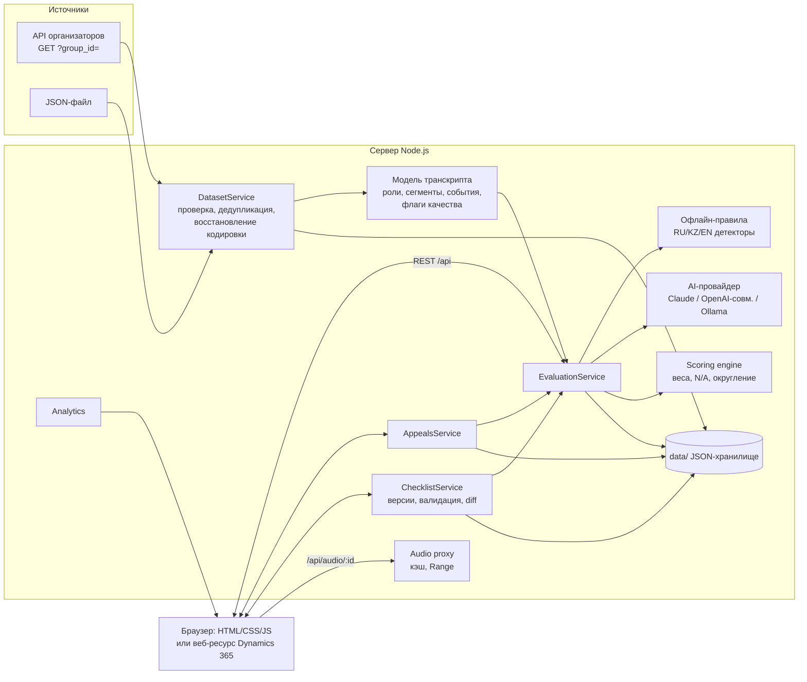

# Архитектура Freedom CQA

## Принципы

1. **Доказательства прежде вывода.** Каждый ответ по критерию содержит обоснование и ссылки на реальные реплики (ID, время, цитата). Цитаты сверяются с транскриптом, время берётся из транскрипта, а не из ответа модели.
2. **Балл считает код, а не модель.** AI или офлайн-правила возвращают только *ответ по шкале критерия*. Итог считает детерминированный модуль `shared/scoring-engine.js` по весам, правилу N/A и округлению из активного чек-листа. Тот же модуль работает в браузере для живого пересчёта при решении апелляции.
3. **Конфигурация — данные.** Чек-лист — версионируемый JSON. Каждая оценка хранит снимок версии, по которой выполнена; изменение чек-листа не переписывает прошлые оценки.
4. **Нет уверенности — нет балла.** Невалидный ответ модели, отсутствие детектора, повреждённый текст → «не оценён» + ручная проверка, а не тихий ноль.
5. **Ничего не удаляется.** Решения проверяющих хранятся рядом с исходным результатом; история апелляций и версий чек-листа неизменна.

## Компоненты

| Слой | Модули | Ответственность |
|---|---|---|
| Данные | `server/data/dataset-validator.js`, `dataset-service.js`, `transcript-model.js` | Разбор ответа API (`isSuccess`, `data.records`), ошибки и предупреждения, дубликаты, `group_id`; нормализация ролей; относительное время (MM:SS для чатов, ISO 8601 для звонков); сегменты (до оператора / очередь / живой диалог / удержание / после завершения); системные события (эскалация, идентификация, удержание, пауза записи) |
| Качество текста | `shared/text-quality.js` | Обнаружение и восстановление «кракозябр» (UTF-8, прочитанный как CP1251) с сохранением оригинала и метода; флаги: маскированные данные, DTMF, обрывки ASR, смешение алфавитов, символы-заменители |
| Чек-лист | `shared/checklist-schema.js`, `server/checklist/checklist-service.js` | Схема (типы ответов: Да/Нет, шкала со ступенями, варианты; роль «с весом» или «флаг»; N/A; режим оценки; детектор), неизменяемые версии, активация, сравнение |
| Оценка | `server/evaluation/*` | Конвейер оценки, AI-провайдеры, промпт, JSON-схема ответа, проверка ответа, офлайн-правила, обогащение доказательств, приоритет ручной проверки |
| Расчёт | `shared/scoring-engine.js` | Итог, разделы, покрытие, грубые ошибки, решения проверяющего, сравнение двух расчётов |
| Пересмотр | `server/appeals/appeals-service.js` | Апелляции: статусы, роли, решения, история |
| Аналитика | `server/analytics/analytics-service.js` | Агрегаты без цитат из диалогов |
| Аудио | `server/audio/audio-service.js` | Скачивание записи по подписанной ссылке на сервере, кэш, отдача с Range, понятные ошибки при истёкшей ссылке |
| HTTP | `server/app.js`, `server/routes/*`, `server/http/*` | REST API, статика, CSP и другие заголовки, CORS по списку, лимиты тела запроса |
| Интерфейс | `public/js/*` | Хэш-роутер, страницы, компоненты (транскрипт, плеер, карточки критериев, графики) |

## Конвейер оценки одного диалога

1. Загрузить диалог и **активную** версию чек-листа (или указанную).
2. Офлайн-правила выполняются всегда: это предварительный скрининг грубых нарушений и сигналов риска (даже если AI с ними не согласится, сигнал не теряется — он помечается «AI не подтвердил» и уходит на проверку).
3. Если доступен AI: один вызов модели на диалог. Промпт = системные правила + блок чек-листа (кэшируется между диалогами) + транскрипт в `<transcript_data>` (ID реплик, роли, время, флаги качества). Ответ — строго JSON по схеме. При невалидном ответе — один повтор с указанием ошибок, затем откат на правила (помечается) или ошибка.
4. Проверка ответа: допустимые значения шкалы, запрет N/A там, где он не разрешён, существование ID реплик, сверка цитат, все критерии на месте. Нарушение → «не оценён» + ручная проверка.
5. Критерии в режиме `llm` без AI → «не оценён»; в режиме `rules` → всегда правила.
6. Доказательства обогащаются временем и цитатой из транскрипта.
7. Расчёт итога (`computeScore`), грубые ошибки и риски, приоритет ручной проверки (критический / высокий / средний / низкий) с причинами.
8. Решения проверяющего из прошлой оценки переносятся, только если не изменились транскрипт, формулировка/шкала/N/A критерия и используемые им общие параметры чек-листа (порог первой реакции — для 06); иначе в истории фиксируется, что решение не перенесено, и диалог уходит на проверку.
9. Оценка сохраняется целиком: снимок чек-листа, результаты, исходный и итоговый расчёт, движок и модель, токены и стоимость, история.

## Расчёт балла (официальные правила)

- Вес критерия с ответом «Да» начисляется полностью, «Нет» — 0; шкала — пропорционально (верхняя ступень = полный вес).
- N/A: вес исключается, максимум остаётся 100 — веса применимых критериев пропорционально увеличиваются (`redistribute_proportional`). Доступны и другие политики (внутри раздела, «считать выполненным») — только если их явно выбрать в новой версии.
- Округление итога — до 2 знаков (half-up), без накопления ошибок двоичной арифметики.
- Если применимых критериев с весом нет — итог не рассчитывается.
- Грубые ошибки (критерий 08) отмечаются отдельно и **не обнуляют** итог (`flag_only`): в официальном чек-листе такого правила нет. Политики `zero_total` / `cap_total` есть, но включаются только явно.

## Хранение

`data/` (вне Git):

| Путь | Содержимое |
|---|---|
| `datasets/<GROUP>.raw.json` | Ответ API или файл байт-в-байт (содержит подписанные ссылки на записи) |
| `datasets/meta.json` | Активный набор, источники, отчёт о проверке |
| `store/checklists.json` | Все версии чек-листа и номер активной |
| `store/evaluations/*.json` | Оценки (по файлу на оценку) |
| `store/appeals.json` | Апелляции с историей |
| `cache/audio/` | Скачанные записи |

Запись атомарная (временный файл + переименование, очередь на файл). Слой хранения изолирован (`server/storage/json-store.js`) и заменяется на БД без изменения сервисов.

## Безопасность

- Подписанная ссылка API и ссылки на записи используются только на сервере; в логах маскируются (`server/lib/logger.js`); клиент получает записи через `/api/audio/:id`.
- Ключи AI — только в `.env` на сервере.
- Транскрипт — данные, а не инструкции: он изолирован в `<transcript_data>`, системный промпт требует игнорировать любые указания внутри диалога; модель не может назначить балл — только ответ по шкале, который проверяется.
- Вывод пользовательского текста — только `textContent`; CSP `default-src 'self'`, без inline-скриптов и стилей; `frame-ancestors` настраивается для Dynamics 365.
- Входящий JSON проверяется (размер, структура); ошибки API и модели обрабатываются с понятными сообщениями.
- Операций удаления истории нет.

## Встраивание в Dynamics 365

См. [DYNAMICS365.md](DYNAMICS365.md): `?embed=1` (без боковой панели), `?data=<conversation_id>` (параметр, который Dynamics передаёт веб-ресурсу), `public/js/config.js → apiBase`, `CORS_ORIGINS`, `FRAME_ANCESTORS`.
